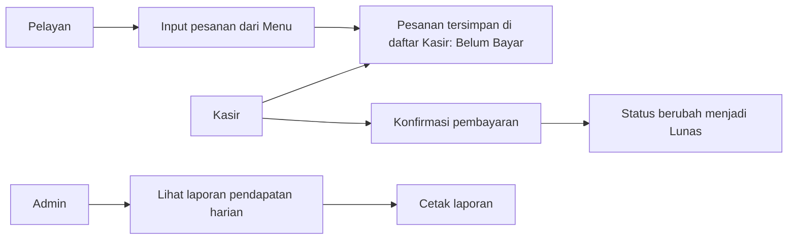

# Use Case Diagram

The application now uses a direct order-to-cashier flow:

Order statuses are limited to **Belum Bayar** and **Lunas**. The cashier can print
the daily revenue report for a selected date; it includes only paid transactions.
